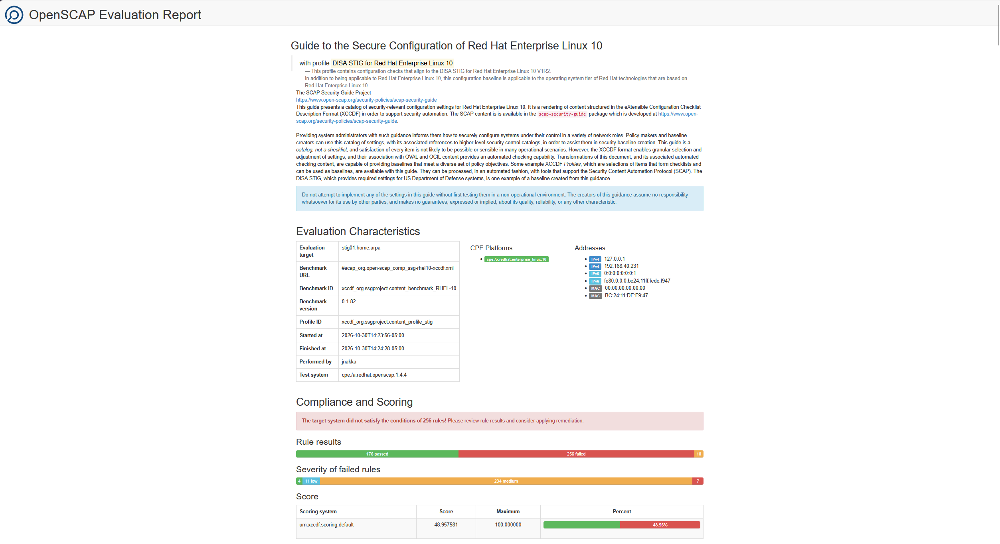
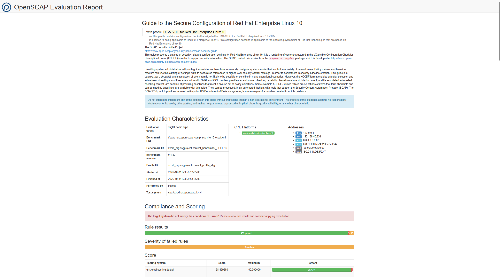

# RHEL 10 STIG Hardening and RMF Lab

> **Result:** DISA STIG compliance raised from **49.0% to 98.4%** (256 failed rules down to 3). All 7 CAT I findings fixed by hand; the bulk of CAT II/III automated with Ansible; the remaining 3 findings tracked in a POA&M.

A homelab project that takes a fresh Red Hat Enterprise Linux 10 server through a small-scale version of the DoD Risk Management Framework (RMF): scan it against the DISA STIG, fix the findings by hand and with Ansible, track what's left in a POA&M, and keep monitoring it with weekly patch and compliance reports.

## Lab environment

| Component | Details |
|---|---|
| Hypervisor | Proxmox VE 9.2 on a Lenovo ThinkCentre M920q |
| Target system | `stig01`, RHEL 10.2, minimal install (no GUI) |
| Compliance scanner | OpenSCAP with `scap-security-guide`, DISA STIG profile for RHEL 10 |
| Vulnerability scanner | Nessus Essentials |
| Automation | Ansible |
| Checklists | DISA STIG Viewer |

Full build details, including the STIG partition layout and why each setting was chosen: [`docs/build.md`](docs/build.md).

## How the project maps to RMF

| RMF step | What I did | Where it lives |
|---|---|---|
| 1. Categorize | Described the system and rated its impact | [`docs/ssp.md`](docs/ssp.md) |
| 2. Select | Chose the DISA STIG as the control baseline | [`docs/ssp.md`](docs/ssp.md) |
| 3. Implement | Fixed findings manually, then automated with Ansible | [`docs/remediation.md`](docs/remediation.md), [`ansible/`](ansible/) |
| 4. Assess | Baseline and post-remediation scans | [`scans/`](scans/) |
| 5. Authorize | Documented accepted risks and open items | [`docs/poam.md`](docs/poam.md) |
| 6. Monitor | Weekly patching, rescans, and log/account review | [`MAINTENANCE.md`](MAINTENANCE.md), [`reports/weekly/`](reports/weekly/) |

## Results

| Scan | Date | Compliance score | Findings failed |
|---|---|---|---|
| Baseline (fresh install) | 2026-10-30 | 49.0% | 256 (7 CAT I, 234 CAT II, 11 CAT III, 4 unrated) |
| After 7 CAT I manual fixes + DISA STIG Ansible playbook | 2026-10-31 | **96.6%** | 8 (0 CAT I, 8 CAT II) |
| **Final:** 5 more CAT II fixed by hand; rest in POA&M | 2026-10-31 | **98.4%** | 3 (all CAT II, all in the [POA&M](docs/poam.md)) |

Profile: DISA STIG for RHEL 10 (`xccdf_org.ssgproject.content_profile_stig`), aligned to **STIG V1R2**. Content: scap-security-guide 0.1.82. Scanner: OpenSCAP 1.4.4.

| Baseline: 49.0%, 256 failed | Final: 98.4%, 3 failed |
|---|---|
|  |  |

- Baseline breakdown by severity, NIST 800-53 family, and area, plus every CAT I finding: [`scans/baseline/summary.md`](scans/baseline/summary.md)
- Final breakdown of the 3 remaining findings: [`scans/final/summary.md`](scans/final/summary.md)
- Post-playbook breakdown and the 8 findings left at that point: [`scans/remediated/summary.md`](scans/remediated/summary.md)
- Every manual fix with its check, fix, and verification evidence: [`docs/remediation.md`](docs/remediation.md)
- Remaining findings, accepted risks, and residual risks found during testing: [`docs/poam.md`](docs/poam.md)
- How the playbook was reviewed and run, including the fapolicyd lockout: [`ansible/README.md`](ansible/README.md)
- Full HTML reports (download and open in a browser): [baseline](scans/baseline/report.html), [after the playbook](scans/remediated/report.html), [final](scans/final/report.html)

**Why a minimal install scored only 49%:** most STIG rules check for settings that must be actively configured (audit rules, PAM password and lockout policy, SSH restrictions, mount options, kernel parameters), not for software that shouldn't be installed. RHEL ships with general-purpose defaults, not DoD defaults.

## Repo layout

```
├── ansible/          How the STIG playbook was reviewed and run, plus the run log
├── docs/
│   ├── build.md      How the VM and OS were built, and why
│   ├── images/       Screenshots
│   ├── remediation.md  Manual fixes: check, fix, and verification for each finding
│   ├── ssp.md        System Security Plan (lite)
│   └── poam.md       Plan of Action and Milestones
├── notes/
│   └── journal.md    Lab journal: commands, errors, and what I learned
├── reports/weekly/   Weekly continuous-monitoring reports
├── scans/
│   ├── baseline/     OpenSCAP results before any changes
│   ├── remediated/   OpenSCAP results after CAT I fixes and the Ansible playbook
│   └── final/        OpenSCAP results after the remaining manual fixes
├── scripts/          Helper scripts (scan summary, weekly report)
└── MAINTENANCE.md    Operations runbook and cadence
```

## What I learned

- **Most STIG findings were settings nobody wrote down.** SSH already refused empty passwords. dnf already checked signatures on repo packages. Both still failed because nobody had written the secure setting into a config file, so it could drift or change with a package update.
- **Read official fixes before running them.** The STIG's GRUB fix text only changes one of the two lines that reference `root`. Following it as written would have locked me out of editing boot entries. The official Ctrl-Alt-Del fix appends to `/etc/systemd/system.conf`, but RHEL 10 doesn't ship that file anymore. The result would have been a config systemd ignores.
- **Several rules can touch the same control.** I skipped the task that enabled fapolicyd, and that wasn't enough. A different rule restarted it and blocked Ansible 1,060 tasks into the run.
- **Test the controls themselves.** I ran a live Ctrl-Alt-Del burst, tried to edit a GRUB entry, and ran an untrusted binary. All three controls held. The fapolicyd test also turned up a real gap the scanner doesn't report: RHEL's default rules allow shell scripts.
- **Some failures are just timing.** Right after a NetworkManager change, `/etc/resolv.conf` looked unchanged. I read it again a moment later and the fix was there.

## A note on passwords: NIST vs. the STIG

NIST SP 800-63B Rev. 4 says not to force periodic password changes. The RHEL 10 STIG (RHEL-10-600100) still requires a 60-day maximum password age. This system follows the STIG, because on DoD systems the STIG is the enforced baseline. The conflict is documented in the POA&M.
