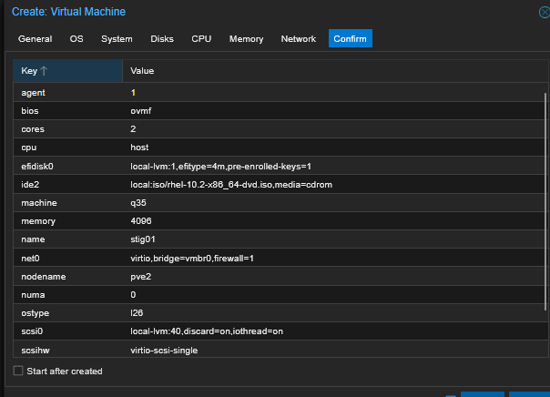
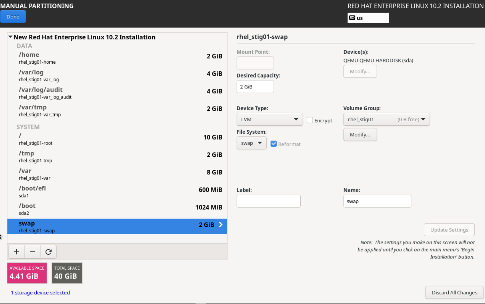
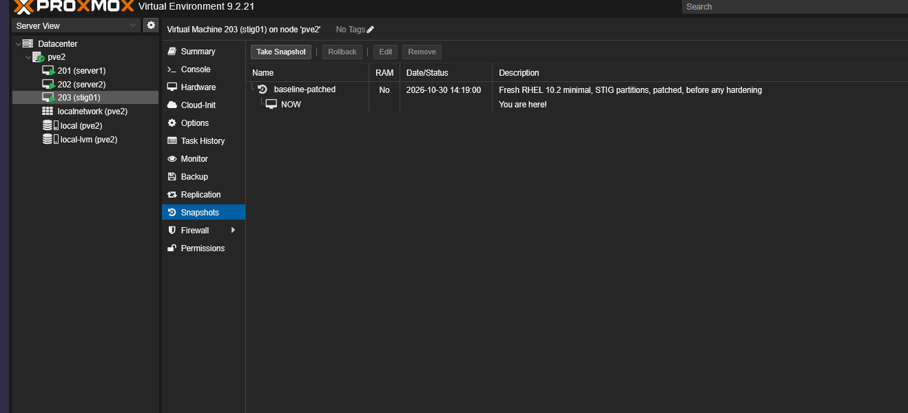

# System Build

How `stig01` was built, and why each choice was made. The goal was a realistic DoD-style server: headless, minimal, partitioned to STIG requirements at install time, and left unhardened so the baseline scan shows a true "before" picture.

## Virtual machine

Proxmox VE 9.2 on a Lenovo ThinkCentre M920q (node `pve2`), VM ID 203.



| Setting | Value | Why |
|---|---|---|
| CPU type | `host` | RHEL 10 requires the x86-64-v3 instruction set. Proxmox's default CPU type hides it, and the installer fails to boot. |
| Firmware | OVMF (UEFI), Secure Boot keys enrolled | Matches modern servers; several STIG rules assume UEFI. |
| Machine | q35 | Modern chipset emulation, required for a clean UEFI setup. |
| Disk | 40 GB, VirtIO SCSI single, discard on | Room for the STIG partition layout; discard returns freed space to the host. |
| Memory | 4 GB | Headroom for full OpenSCAP and Nessus scans. |
| Network | VirtIO on `vmbr0`, static `192.168.40.231/24` | Needs internet access for patching. |

## Operating system install

| Choice | Value | Why |
|---|---|---|
| Release | RHEL 10.2 | Current release with a published DISA STIG. |
| Software | Minimal Install, no add-ons | Smallest attack surface (NIST 800-53 CM-7, Least Functionality). |
| Security profile | None | The baseline scan should show an unhardened system. RHEL 10's graphical installer no longer offers this option. |
| Root account | Locked | Admin access goes through a named user and `sudo`, so every privileged action is tied to a person in the logs. |
| Time | America/New_York, NTP on (`2.rhel.pool.ntp.org`) | Accurate time keeps audit logs trustworthy. The public pool is left in place on purpose; the STIG expects an authoritative time source, so it should appear as a finding. |
| Kdump | Left enabled (default) | The STIG says to disable it unless needed; left on so the baseline captures it. |
| FIPS mode | Enabled at install | The installer was booted with `fips=1` on its kernel command line (confirmed in `/var/log/anaconda/journal.log`), and it ran its "Set up FIPS for the payload installation" and "Configure FIPS" tasks. RHEL 10 only supports enabling FIPS mode at install time; switching an installed system to FIPS isn't supported. The kernel argument wasn't added deliberately during this build, and whether it came from the ISO's boot menu entry hasn't been checked. |
| Disk encryption | Not enabled | A LUKS passphrase at every VM boot isn't practical in a homelab. Tracked as an accepted risk in the [POA&M](poam.md). |

## Partitioning

The STIG requires separate filesystems for several directories so that one filling up (for example, an attacker flooding the logs) can't crash the system or stop audit logging. It also allows restrictive mount options such as `noexec` on `/tmp`. These are hard to change after installation, so they were created at install time.



| Mount point | Size | Type |
|---|---|---|
| `/boot/efi` | 600 MiB | Standard partition (EFI System Partition) |
| `/boot` | 1 GiB | Standard partition, xfs |
| `/` | 10 GiB | LVM, xfs |
| `/home` | 2 GiB | LVM, xfs |
| `/tmp` | 2 GiB | LVM, xfs |
| `/var` | 8 GiB | LVM, xfs |
| `/var/log` | 4 GiB | LVM, xfs |
| `/var/log/audit` | 4 GiB | LVM, xfs |
| `/var/tmp` | 2 GiB | LVM, xfs |
| swap | 2 GiB | LVM |

`/boot` and `/boot/efi` sit outside LVM because the firmware and bootloader read them before Linux (and LVM) are running. About 4.4 GiB of the disk is left unallocated for growing volumes later with `vgextend` and `lvextend`.

Result on the running system:

```
$ lsblk
NAME                          MAJ:MIN RM  SIZE RO TYPE MOUNTPOINTS
sda                             8:0    0   40G  0 disk
├─sda1                          8:1    0  600M  0 part /boot/efi
├─sda2                          8:2    0    1G  0 part /boot
└─sda3                          8:3    0   34G  0 part
  ├─rhel_stig01-root          253:0    0   10G  0 lvm  /
  ├─rhel_stig01-swap          253:1    0    2G  0 lvm  [SWAP]
  ├─rhel_stig01-var_tmp       253:2    0    2G  0 lvm  /var/tmp
  ├─rhel_stig01-var_log       253:3    0    4G  0 lvm  /var/log
  ├─rhel_stig01-tmp           253:4    0    2G  0 lvm  /tmp
  ├─rhel_stig01-home          253:5    0    2G  0 lvm  /home
  ├─rhel_stig01-var           253:6    0    8G  0 lvm  /var
  └─rhel_stig01-var_log_audit 253:7    0    4G  0 lvm  /var/log/audit
```

## Post-install

| Step | Detail |
|---|---|
| Registration | `subscription-manager register` (updates only). `rhc connect` was avoided because it also installs a remote-management agent, which adds attack surface. |
| Patching | `dnf upgrade`; `dnf needs-restarting -r` reported kernel, glibc, systemd and others required a reboot. Kernel went from `6.12.0-211.7.3` to `6.12.0-211.69.1`; after reboot `needs-restarting` exited 0. |
| Guest agent | `qemu-guest-agent` was already installed: the installer detects a KVM guest and adds it even on Minimal Install. Enabled and verified `active` so Proxmox can report the IP and shut the VM down cleanly. |
| FIPS check | `cat /proc/sys/crypto/fips_enabled` returns `1`; `update-crypto-policies --show` returns `FIPS`; `fips=1` is in `GRUB_CMDLINE_LINUX` in `/etc/default/grub`. |
| Snapshot | Proxmox snapshot `baseline-patched` taken before any hardening, so the system can be rolled back and the Ansible playbook re-tested from a clean state. |


